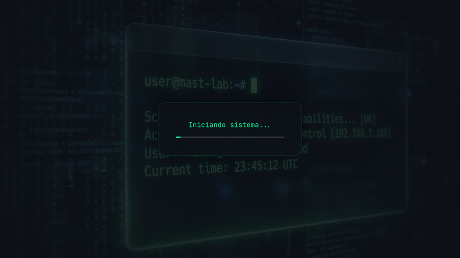

# 🚀 [terminal.alejandrobriz.es](https://terminal.alejandrobriz.es)

> **Terminal Mastery Lab** — Interactive in-browser Linux/Unix terminal simulator to learn, practice, and master the shell from beginner to DevOps and SysAdmin. 100% Free & Open Source.
>
> **Terminal Mastery Lab** — Simulador interactivo de terminal Linux/Unix en el navegador para aprender, practicar y dominar la consola desde cero hasta nivel DevOps y SysAdmin. 100% libre y gratuito.



---

## 🌐 English

Welcome to **Terminal Mastery Lab**! Learn bash commands, filesystem navigation, permissions, scripting, process management, networking, and DevOps tools right inside your browser with a retro CRT aesthetic, real sound effects, and RPG-like progression.

- 🎮 **Play Online**: [https://terminal.alejandrobriz.es](https://terminal.alejandrobriz.es)
- 🔓 **Full Access**: All missions (Apprentice + PRO) unlocked from start to finish.
- ⚡ **No Installation Required**: Runs entirely client-side in pure HTML5, CSS3, and modern JavaScript.

---

### 🛠️ How to Create a New Level (3 Steps)

Anyone can easily contribute new missions! All level definitions are modularized inside the [`/levels`](levels) folder.

#### 1. Open the Level File
Go to [`levels/apprentice-missions.js`](levels/apprentice-missions.js) or [`levels/pro-missions.js`](levels/pro-missions.js).

#### 2. Define the Mission Schema
Add a new mission object to the array:
```javascript
{
    id: 'm_custom_1',
    titleKey: 'm_custom_1_title',
    descKey: 'm_custom_1_desc',
    objectives: [
        { id: 'obj1', textKey: 'm_custom_1_o1', completed: false }
    ],
    check: (cmd, args, output) => {
        const mission = window.missionsRef[window.currentMissionIndexRef.value];
        // Validation logic: command, arguments or VFS state
        if (cmd === 'uptime') {
            mission.objectives[0].completed = true;
        }

        if (window.updateObjectivesGlobal) window.updateObjectivesGlobal();
        if (mission.objectives.every(o => o.completed) && window.nextMissionGlobal) {
            window.nextMissionGlobal();
        }
    }
}
```

#### 3. Add Translations & Test
In [`translations.js`](translations.js), add the text keys for both `en` and `es`:
```javascript
// Inside en:
m_custom_1_title: "System Uptime",
m_custom_1_desc: "Check how long the system has been running.",
m_custom_1_o1: "Run `uptime` to inspect system load.",

// Inside es:
m_custom_1_title: "Tiempo de Actividad",
m_custom_1_desc: "Comprueba cuánto tiempo lleva el sistema encendido.",
m_custom_1_o1: "Ejecuta `uptime` para ver la carga del sistema.",
```
Open `index.html` in any browser or launch a static server. You are ready!

---

### ☕ Support & Consultancy

If this simulator helped you learn Linux or you need professional assistance:
- 💼 **Web & Cloud Consulting**: [alejandrobriz.es](https://alejandrobriz.es)
- ☕ **Buy Me a Coffee**: [buymeacoffee.com/comeranas](https://buymeacoffee.com/comeranas)
- 💖 **GitHub Sponsors**: [github.com/sponsors](https://github.com/sponsors)

---

## 🇪🇸 Español

¡Bienvenido a **Terminal Mastery Lab**! Aprende comandos bash, navegación de archivos, permisos, scripts, administración de procesos, redes y herramientas DevOps directamente en el navegador con estética CRT retro, efectos sonoros y progresión de niveles.

- 🎮 **Jugar Online**: [https://terminal.alejandrobriz.es](https://terminal.alejandrobriz.es)
- 🔓 **Acceso Completo**: Todos los niveles (Aprendiz + PRO) están liberados de principio a fin.
- ⚡ **Sin Instalación**: Funciona 100% en el navegador con HTML5, CSS y JavaScript vanilla.

---

### 🛠️ Cómo Crear un Nivel Nuevo (3 Pasos)

¡Cualquiera puede colaborar añadiendo nuevos niveles! Las misiones están totalmente desacopladas en la carpeta [`/levels`](levels).

#### 1. Abre el archivo de niveles
Entra en [`levels/apprentice-missions.js`](levels/apprentice-missions.js) o [`levels/pro-missions.js`](levels/pro-missions.js).

#### 2. Define el esquema del nivel
Añade un objeto de misión con enunciado, objetivos y validación:
```javascript
{
    id: 'm_custom_1',
    titleKey: 'm_custom_1_title',
    descKey: 'm_custom_1_desc',
    objectives: [
        { id: 'obj1', textKey: 'm_custom_1_o1', completed: false }
    ],
    check: (cmd, args, output) => {
        const mission = window.missionsRef[window.currentMissionIndexRef.value];
        // Lógica de validación: comando ejecutado, argumentos o estado en el VFS
        if (cmd === 'uptime') {
            mission.objectives[0].completed = true;
        }

        if (window.updateObjectivesGlobal) window.updateObjectivesGlobal();
        if (mission.objectives.every(o => o.completed) && window.nextMissionGlobal) {
            window.nextMissionGlobal();
        }
    }
}
```

#### 3. Añade los textos en translations.js y prueba
En [`translations.js`](translations.js), agrega las claves tanto en `es` como en `en`:
```javascript
// Dentro de es:
m_custom_1_title: "Tiempo de Actividad",
m_custom_1_desc: "Comprueba cuánto tiempo lleva el sistema encendido.",
m_custom_1_o1: "Ejecuta `uptime` para ver la carga del sistema.",

// Dentro de en:
m_custom_1_title: "System Uptime",
m_custom_1_desc: "Check how long the system has been running.",
m_custom_1_o1: "Run `uptime` to inspect system load.",
```
¡Abre `index.html` en tu navegador y verás tu nivel cargado automáticamente!

---

### ☕ Soporte y Consultoría

Si este simulador te ha sido útil o necesitas consultoría para tu empresa:
- 💼 **Consultoría Web & DevOps**: [alejandrobriz.es](https://alejandrobriz.es)
- ☕ **Invitar a un café**: [buymeacoffee.com/comeranas](https://buymeacoffee.com/comeranas)
- 💖 **Patrocinar en GitHub**: [github.com/sponsors](https://github.com/sponsors)
